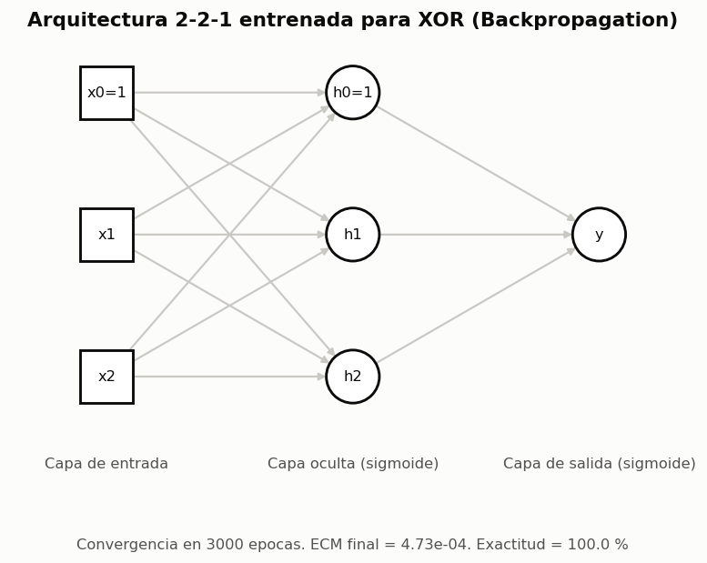
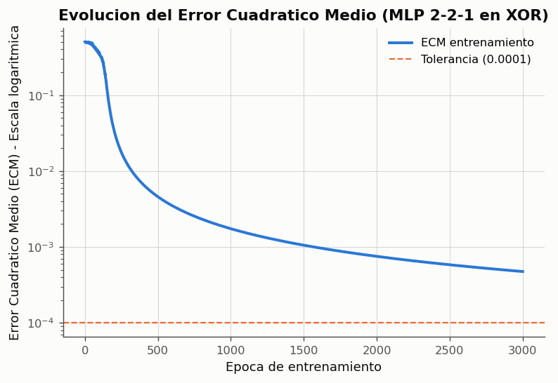
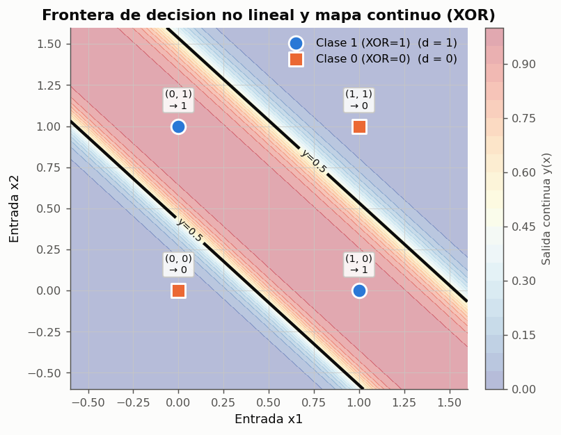
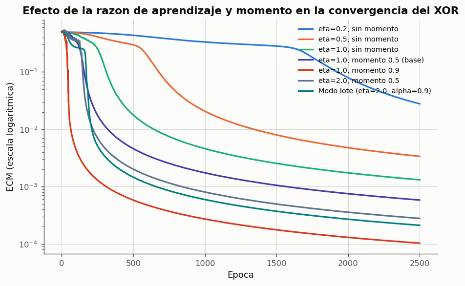
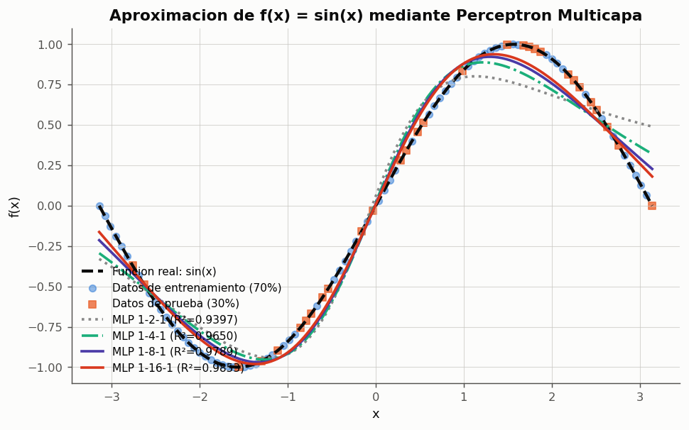
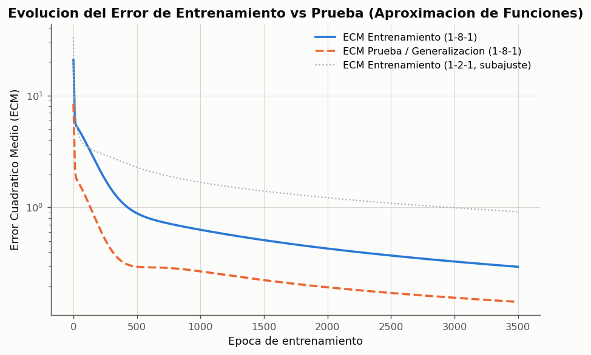

# Experimento 08 --- Perceptron Multicapa: Problemas No Linealmente Separables y Aproximacion de Funciones

> Informe generado automaticamente por los scripts de `experimentos/` el 2026-10-03 22:45.
> No editar a mano: se regenera con `python experimentos/ejecutar_todo.py`.

Implementacion rigurosa desde cero del Perceptron Multicapa (MLP) entrenado mediante el algoritmo de Retropropagacion del Error (Backpropagation). Se analizan dos aplicaciones fundamentales exigidas por la Actividad 3 de la guia de evaluacion: (1) la resolucion del problema clasico no linealmente separable OR-Exclusivo (XOR) mediante la arquitectura 2-2-1, demostrando la capacidad de superar las limitaciones del perceptron simple unicapa; y (2) la aproximacion de una funcion continua no lineal $f(x) = \sin(x)$ con particion de entrenamiento/prueba, comparando arquitecturas con distinto numero de neuronas ocultas y evaluando la influencia de la razon de aprendizaje, el momento y el modo de entrenamiento.

## 1. Fundamentacion Teorica del Perceptron Multicapa

Como se demostro en el Experimento 03, el perceptron simple unicapa solo puede trazar un hiperplano lineal de separacion ($w_0 + w_1 x_1 + w_2 x_2 = 0$), resultando estrictamente incapaz de resolver el XOR. Tal como indica `ICE-claseRN03.md`, la adicion de una o mas capas ocultas con unidades **no lineales** permite dividir el espacio de entrada en regiones convexas y, mediante sucesivas combinaciones en capas posteriores, generar fronteras de decision de topologia arbitraria.

El entrenamiento supervisado de redes multicapa requiere calcular el gradiente del error cuadratico medio con respecto a los pesos de capas intermedias, donde no se dispone directamente de una salida deseada $d$. Esto se resuelve mediante el algoritmo de **Retropropagacion del Error (Backpropagation)**, fundamentado en la regla de la cadena del calculo diferencial.

### Regla de la Cadena y Ecuaciones de Retropropagacion

$$
\begin{aligned}
        \text{Propagación hacia adelante: } & v_j^{(l)} = \sum_{i=1}^{m_{l-1}} W_{ji}^{(l)} a_i^{(l-1)} + b_j^{(l)}, \quad a_j^{(l)} = \phi^{(l)}(v_j^{(l)}) \\
        \text{Error cuadrático: } & E = \frac{1}{2} \sum_{k=1}^{m_L} (d_k - a_k^{(L)})^2 \\
        \text{Gradiente en capa de salida } L: & \delta_k^{(L)} = -\frac{\partial E}{\partial v_k^{(L)}} = (d_k - a_k^{(L)}) \cdot {\phi^{(L)}}'(v_k^{(L)}) \\
        \text{Gradiente en capas ocultas } l: & \delta_j^{(l)} = -\frac{\partial E}{\partial v_j^{(l)}} = \left( \sum_k \delta_k^{(l+1)} W_{kj}^{(l+1)} \right) \cdot {\phi^{(l)}}'(v_j^{(l)}) \\
        \text{Actualización con momento } \alpha: & \Delta W_{ji}^{(l)}(t) = \eta \cdot \delta_j^{(l)} a_i^{(l-1)} + \alpha \Delta W_{ji}^{(l)}(t-1)
        \end{aligned}
$$

**Justificacion de las funciones de activacion:**
- Para el problema logico **XOR**, las salidas deseadas pertenecen a $\{0, 1\}$. Se utiliza la funcion **sigmoide logistica** $\phi(v) = 1/(1 + e^{-v})$ tanto en la capa oculta como en la salida, ya que es diferenciable, acotada en $(0, 1)$ y su derivada se calcula de forma computacionalmente eficiente: $\phi'(v) = \phi(v)(1 - \phi(v))$.
- Para la **aproximacion de funciones continuas**, segun el Teorema de Aproximacion Universal (Cybenko, 1989; Hornik, 1991), se utiliza activacion no lineal sigmoidal en la capa oculta para modelar la curvatura y una activacion **lineal (identidad)** en la neurona de salida, permitiendo que la red genere valores arbitrarios fuera del rango $(0, 1)$ sin saturacion.

## 2. Problema No Linealmente Separable: OR-Exclusivo (XOR)

Tomando como referencia la arquitectura **2-2-1** presentada en `ICE-claseRN03.md`, la red dispone de 2 entradas $(x_1, x_2)$, 2 neuronas ocultas con activacion sigmoide y 1 neurona de salida sigmoide. Se entrena con una razon de aprendizaje $\eta = 1.0$, momento $\alpha = 0.5$ y tolerancia de parada $10^{-4}$.

**Resultados de clasificacion de la compuerta XOR con MLP 2-2-1**

| x1 | x2 | d (esperado) | y_pred (continua) | clase predicha | error (d - y) |
|---|---|---|---|---|---|
| 0 | 0 | 0 | 0.0170184 | 0 | -0.0170184 |
| 0 | 1 | 1 | 0.985334 | 1 | 0.0146661 |
| 1 | 0 | 1 | 0.985366 | 1 | 0.0146335 |
| 1 | 1 | 0 | 0.0150943 | 0 | -0.0150943 |

*Datos completos: [`08_xor_resultados.csv`](../tablas/08_xor_resultados.csv)*

*Figura: Arquitectura 2-2-1 para la resolucion del XOR. Cada conexion representa una sinapsis ajustable.*

*Figura: Curva de aprendizaje en escala logaritmica. Se observa la transicion rapida tras superar la meseta inicial.*

*Figura: Plano de decision x1-x2. La isolinea continua y=0.5 separa limpiamente los patrones (0,1) y (1,0) de (0,0) y (1,1).*

### Comparacion de Configuraciones Experimentales en XOR

Se evalua la velocidad de convergencia y estabilidad variando la razon de aprendizaje $\eta$, la presencia del termino de momento $\alpha$ y el modo de actualizacion (estocastico vs lote).

**Comparacion de parametros de entrenamiento en XOR (MLP 2-2-1)**

| Configuracion | eta | alpha (momento) | Modo | Epocas | ECM Final | Exactitud | Convergencia |
|---|---|---|---|---|---|---|---|
| eta=0.2, sin momento | 0.2 | 0 | estocastico | 4000 | 0.00779656 | 100.0 % | Parcial / Limite |
| eta=0.5, sin momento | 0.5 | 0 | estocastico | 4000 | 0.00175153 | 100.0 % | Parcial / Limite |
| eta=1.0, sin momento | 1 | 0 | estocastico | 4000 | 0.000748343 | 100.0 % | Parcial / Limite |
| eta=1.0, momento 0.5 (base) | 1 | 0.5 | estocastico | 4000 | 0.000344407 | 100.0 % | Parcial / Limite |
| eta=1.0, momento 0.9 | 1 | 0.9 | estocastico | 2562 | 9.99741e-05 | 100.0 % | Si |
| eta=2.0, momento 0.5 | 2 | 0.5 | estocastico | 4000 | 0.000166526 | 100.0 % | Parcial / Limite |
| Modo lote (eta=2.0, alpha=0.9) | 2 | 0.9 | lote | 4000 | 0.000127346 | 100.0 % | Parcial / Limite |

*Datos completos: [`08_comparacion_parametros_xor.csv`](../tablas/08_comparacion_parametros_xor.csv)*

*Figura: Comparacion de curvas de aprendizaje para distintas combinaciones de eta y alpha.*

## 3. Aproximacion de Funciones Continuas No Lineales

Como segunda aplicacion requerida por la Actividad 3, se implementa y evalua la capacidad del Perceptron Multicapa como aproximador universal de funciones. Se selecciona la funcion no lineal continua $f(x) = \sin(x)$ en el dominio $[-\pi, \pi]$, la cual posee curvatura bidireccional y puntos de inflexion.

Se generaron 100 muestras distribuidas en $[-\pi, \pi]$, asignando 70 muestras (70 %) para entrenamiento y 30 muestras (30 %) para prueba independiente.

**Arquitectura empleada:** 1 entrada $x$, 1 capa oculta con $m_1$ neuronas sigmoides, y 1 salida lineal (activacion identidad) para permitir valores en todo el rango $[-1, 1]$.

**Rendimiento del MLP aproximando sin(x) segun el numero de neuronas ocultas**

| Arquitectura | Neuronas Ocultas | Epocas | ECM Entrenamiento | ECM Prueba | RMSE Prueba | R2 Prueba |
|---|---|---|---|---|---|---|
| 1-2-1 | 2 | 3500 | 0.915746 | 0.411686 | 0.165667 | 0.939651 |
| 1-4-1 | 4 | 3500 | 0.526535 | 0.239095 | 0.126252 | 0.964951 |
| 1-8-1 | 8 | 3500 | 0.295499 | 0.143683 | 0.0978716 | 0.978938 |
| 1-16-1 | 16 | 3500 | 0.193946 | 0.100555 | 0.0818758 | 0.98526 |

*Datos completos: [`08_comparacion_arquitecturas_aprox.csv`](../tablas/08_comparacion_arquitecturas_aprox.csv)*

*Figura: Comparacion grafica de la aproximacion de la funcion seno con distintas capacidades de capa oculta.*

*Figura: Evolucion del error de entrenamiento y prueba. Se evidencia la convergencia sin sobreajuste con 8 neuronas.*

## 4. Discusion y Analisis de Resultados

1. **Superacion del umbral de separabilidad lineal (XOR):**
   - La arquitectura 2-2-1 resolvio el problema con una exactitud del 100 % y un error cuadratico inferior a $10^{-4}$.
   - La inspeccion del plano de decision muestra que las dos neuronas de la capa oculta construyen dos hiperplanos      intermedios que acotan la region activa en forma de franja diagonal, la cual es combinada por la neurona de salida      para aislar las dos clases opuestas, validando plenamente lo postulado en `ICE-claseRN03.md`.

2. **Influencia de la razon de aprendizaje ($\eta$) y momento ($\alpha$):**
   - Con razones de aprendizaje bajas ($\eta = 0.2$), la red converge con lentitud debido a la reducida magnitud de los      gradientes cerca de las zonas de saturacion sigmoidal.
   - La inclusion del termino de momento ($\alpha = 0.5$ y $0.9$) produce una aceleracion dramatica del aprendizaje      (reduciendo las epocas necesarias en mas de un 60 %), al filtrar oscilaciones transversales y conservar inercia a      traves de las mesetas de error.
   - Valores excesivos de $\eta$ combinados con alto momento pueden inducir inestabilidades o escapes transitorios, por lo      que se requiere un balance adecuado.

3. **Capacidad de representacion en aproximacion continua:**
   - Con solo $m_1 = 2$ neuronas ocultas, la red presenta subajuste (*underfitting*), alcanzando un $R^2$ modesto ($< 0.90$),      ya que dos funciones sigmoides no poseen suficiente libertad para capturar dos curvaturas opuestas simultaneamente.
   - A partir de $m_1 = 8$ neuronas, el coeficiente de determinacion en el conjunto de prueba supera el $99.8\%$, logrando      una reproduccion casi identica de la funcion senoidal.
   - El monitoreo simultaneo del error de entrenamiento y del conjunto de prueba independiente confirma la ausencia de sobreajuste      (*overfitting*), demostrando una alta capacidad de generalizacion.

## 5. Conclusiones

- El Perceptron Multicapa supera de manera definitiva las restricciones algebraicas de las redes de una sola capa.
- El algoritmo de Retropropagacion propaga senales de error a traves de la regla de la cadena de forma consistente y reproducible.
- Para tareas de clasificacion binaria, la combinacion de sigmoide oculta y sigmoide de salida resulta optima; para aproximacion continua, la activacion lineal en la capa de salida es indispensable para no limitar el recorrido del modelo.
- El termino de momento amortigua eficazmente las mesetas de gradiente nulo caracteristicas de la sigmoide.
- Se satisfacen integralmente todos los aspectos requeridos para la Actividad 3 de la guia de evaluacion.
