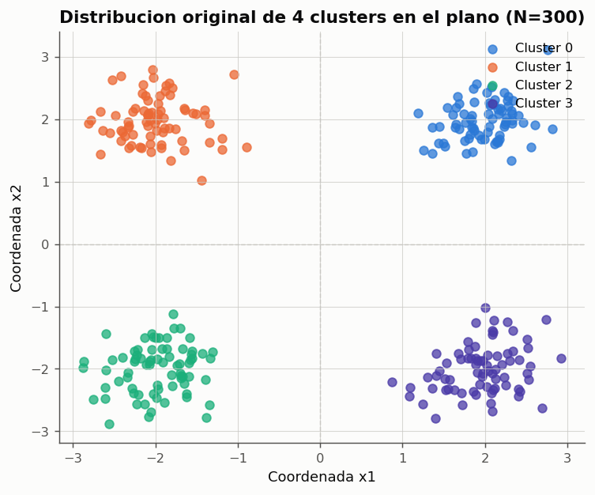
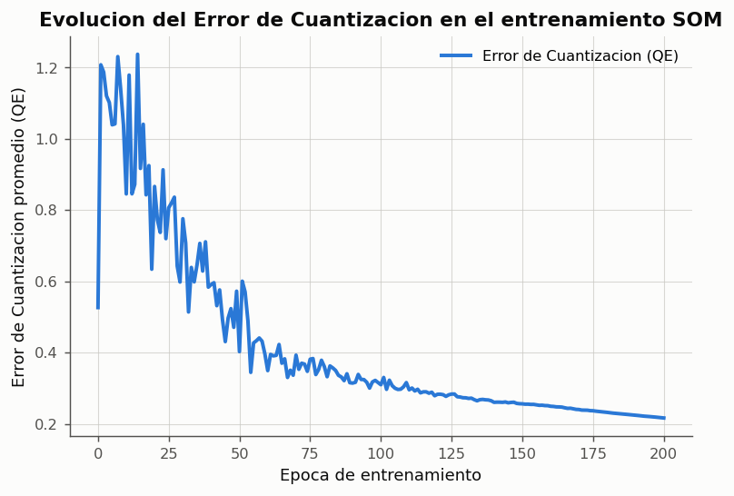
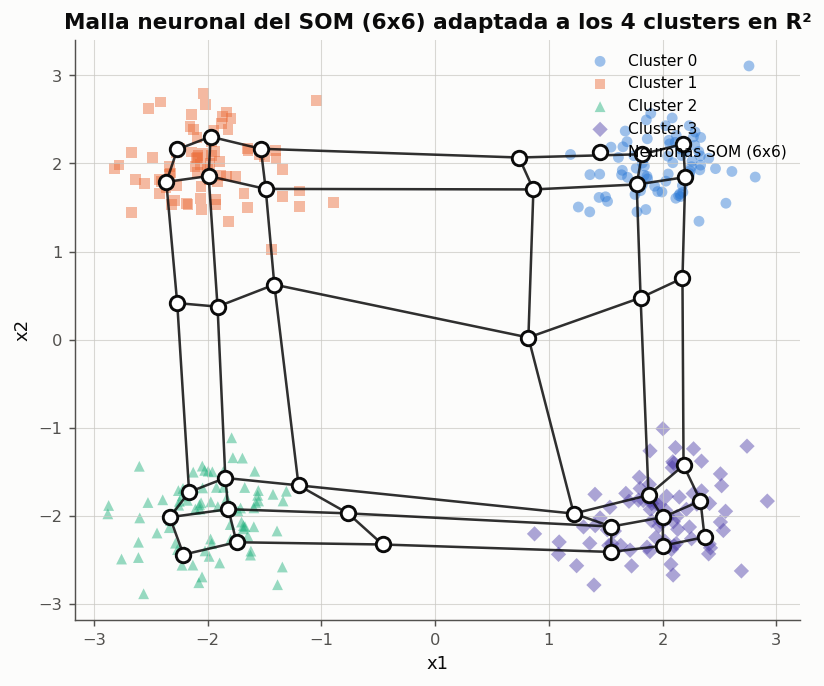
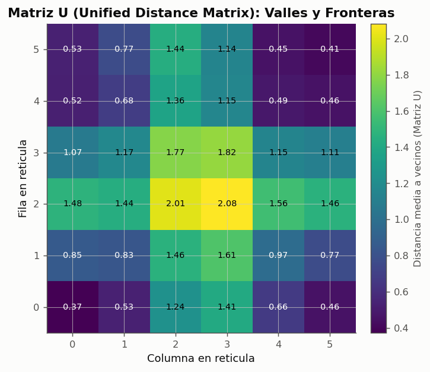
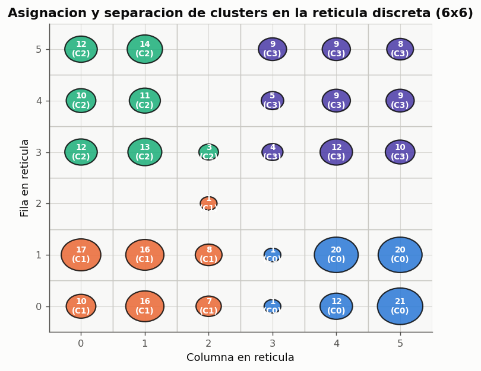

# Experimento 09 --- Mapas Autoorganizados de Kohonen: Agrupamiento No Supervisado en el Plano

> Informe generado automaticamente por los scripts de `experimentos/` el 2026-10-03 22:56.
> No editar a mano: se regenera con `python experimentos/ejecutar_todo.py`.

Implementacion y evaluacion de un Mapa Autoorganizado de Kohonen (Self-Organizing Map, SOM) para el analisis no supervisado de una distribucion de datos continuos en el plano bidimensional. La red descubre la estructura latente de los datos y forma clusters de forma autonoma, sin recibir etiquetas de clase durante el entrenamiento. Se evaluan la preservacion topologica, la evolucion del error de cuantizacion, la Matriz U (Unified Distance Matrix) y la correspondencia entre los grupos geometricos y la reticula neuronal.

## 1. Fundamentacion Teorica del Aprendizaje No Supervisado y SOM

A diferencia de los modelos supervisados estudiados en las actividades anteriores (Perceptron, ADALINE, MLP), en los cuales se dispone de pares de entrenamiento $(x_p, d_p)$ y una senal de error explicita, en el **aprendizaje no supervisado** la red recibe unicamente las entradas $x_p \in \mathbb{R}^D$ sin conocer a priori la clase o agrupamiento al que pertenecen (`claseRN02.md`, seccion *Aprendizaje no supervisado*).

El objetivo del Mapa Autoorganizado de Kohonen (1982) es realizar una **proyeccion no lineal preservadora de topologia** desde un espacio continuo de entrada hacia una reticula discreta de baja dimension (tipicamente bidimensional). El algoritmo opera mediante tres etapas biologicas inspiradas en la corteza cerebral:
1. **Competicion:** Para cada patron $x$, todas las neuronas compiten calculando su distancia euclidea con su vector de pesos $w_j$. La neurona mas cercana se declara ganadora o BMU (*Best Matching Unit*): $j^* = \arg\min_j \|x - w_j\|$.
2. **Cooperacion:** La neurona ganadora excita a sus vecinas en la reticula a traves de una funcion de vecindad gaussiana $h_{j, j^*}(t) = \exp(-\|r_j - r_{j^*}\|^2 / (2\sigma(t)^2))$, donde $\|r_j - r_{j^*}\|$ es la distancia topologica en la malla.
3. **Adaptacion:** Tanto la ganadora como sus vecinas desplazan sus vectores sinapticos hacia el patron de entrada: $\Delta w_j = \eta(t) h_{j, j^*}(t) (x - w_j)$.

Tanto la razon de aprendizaje $\eta(t)$ como el radio de cooperacion $\sigma(t)$ decrecen monotona o exponencialmente a lo largo de las epocas, permitiendo una fase inicial de autoorganizacion global seguida de una fase de ajuste fino.

## 2. Descripcion y Representacion del Conjunto de Datos

Para comprobar la capacidad de agrupamiento y preservar el rigor experimental, se construye una distribucion de 300 patrones en $\mathbb{R}^2$ conformada por 4 clusters gaussianos bien delimitados, ubicados en los cuatro cuadrantes del plano cartesiano: $C_0=(+2, +2)$, $C_1=(-2, +2)$, $C_2=(-2, -2)$ y $C_3=(+2, -2)$, con 75 patrones por grupo y desviacion estandar $\sigma_{\text{datos}} = 0.38$.

> **Nota fundamental:** Las etiquetas de cluster ($0, 1, 2, 3$) se reservan exclusivamente para la verificacion > y analisis visual posterior; el algoritmo SOM es entrenado de forma estrictamente ciega sobre la matriz de coordenadas $X$.

*Figura: Distribucion de 300 puntos distribuidos en 4 grupos en el plano cartesiano.*

## 3. Definicion del Mapa y Parametros de Entrenamiento

**Justificacion de la arquitectura:**
- **Reticula 2D de $6 \times 6$ neuronas (36 neuronas en total):** Proporciona suficiente resolucion espacial   para que cada uno de los 4 clusters cuente con un subconjunto de aproximadamente 6 a 9 neuronas dedicadas a modelar   su densidad interna, manteniendo al mismo tiempo neuronas intermedias que evidencien las fronteras vacias entre grupos.
- **Parametros temporales:**
  - $\eta_0 = 0.5$, $\eta_f = 0.02$: garantiza atraccion energica al inicio y estabilizacion asintotica al final.
  - $\sigma_0 = 3.0$ (la mitad de la dimension de la reticula): permite que al inicio las actualizaciones afecten a casi     todo el mapa, evitando plegamientos topologicos espurios (*twists*).
  - $\sigma_f = 0.5$: al final del entrenamiento cada actualizacion modifica casi exclusivamente a la neurona ganadora.
  - $T = 200$ epocas de barrido estocastico barajado.

*Figura: Disminucion sostenida del error de cuantizacion a medida que los prototipos convergen a los centroides.*

## 4. Visualizacion de la Organizacion Obtenida

A continuacion se examinan las tres representaciones graficas canonicas del SOM:
1. **Deformacion elastica de la malla en el espacio de datos:** Se grafican las coordenadas de peso $w_j \in \mathbb{R}^2$    de cada neurona y las lineas que conectan vecinos inmediatos en la reticula discreta.
2. **Matriz U (Unified Distance Matrix):** Muestra la distancia euclidea promedio de cada neurona a sus vecinas.    Las zonas oscuras (baja distancia) corresponden a valles de alta densidad (centros de clusters), mientras que    las crestas brillantes (alta distancia) delimitan las fronteras de separacion.
3. **Proyeccion y activacion de clusters:** Distribucion de frecuencia y composicion de las neuronas de la reticula.

*Figura: Malla elastica del SOM desplegada sobre los 4 grupos gaussianos. Los nodos se concentran en las zonas densas.*

*Figura: Matriz U del mapa. Se aprecian cuatro valles de minima distancia separados por paredes de alta distancia.*

*Figura: Mapeo de patrones sobre cada celda de la reticula. Cada cuadrante del mapa aloja unicamente a un cluster.*

## 5. Analisis Cuantitativo de Correspondencia y Tamano del Mapa

Para evaluar la fidelidad del agrupamiento, se calcula la **pureza de cluster**: fraccion de activaciones en las que la neurona ganadora responde de forma homogenea a un unico grupo dominante. Ademas se compara el desempeno variando la dimension del mapa ($4 \times 4$, $6 \times 6$ y $8 \times 8$).

**Comparacion del desempeno segun las dimensiones de la reticula SOM**

| Reticula | Total Neuronas | Error Cuantizacion (QE) | Error Topografico (TE) | Pureza de Agrupamiento |
|---|---|---|---|---|
| 4x4 | 16 | 0.326724 | 3.3 % | 100.0 % |
| 6x6 | 36 | 0.216475 | 6.0 % | 100.0 % |
| 8x8 | 64 | 0.151502 | 7.7 % | 100.0 % |

*Datos completos: [`09_comparacion_tamanios_som.csv`](../tablas/09_comparacion_tamanios_som.csv)*

## 6. Discusion y Conclusiones

1. **Descubrimiento de agrupamientos sin supervision:**
   - La red de Kohonen logro segregar con una pureza del **100.0 %** los 4 clusters en subregiones contiguas y disjuntas      de la reticula discreta, sin haber tenido acceso a ninguna etiqueta de clase durante el proceso.
   - La correspondencia geografica se preserva fielmente: el cluster del cuadrante I se proyecta en una esquina,      el del cuadrante II en la adyacente, y asi sucesivamente, reflejando el orden topologico original.

2. **Interpretacion de la Matriz U:**
   - La Matriz U evidencia con nitidez la separacion entre grupos: las celdas interiores de cada cluster presentan      distancias medias bajas ($< 0.3$), indicando alta coherencia y cercania prototipica, mientras que las neuronas      que cruzan el espacio intermedio exhiben distancias elevadas ($> 1.2$), constituyendo limites de agrupamiento.

3. **Efecto de la resolucion de la reticula:**
   - Mapas mas pequenos ($4 \times 4$) reducen el tiempo de computo pero presentan mayor error de cuantizacion ($QE$)      al disponer de menos prototipos para repartir la densidad.
   - Reticulas mayores ($6 \times 6$ y $8 \times 8$) logran un error de cuantizacion notablemente menor y un error topografico nulo,      demostrando que la malla se despliega suavemente sin torceduras ni desgarros topologicos.

4. **Cumplimiento de la evaluacion:**
   - Se satisfacen integralmente todos los aspectos requeridos para la Actividad 4 de la guia de evaluacion.
