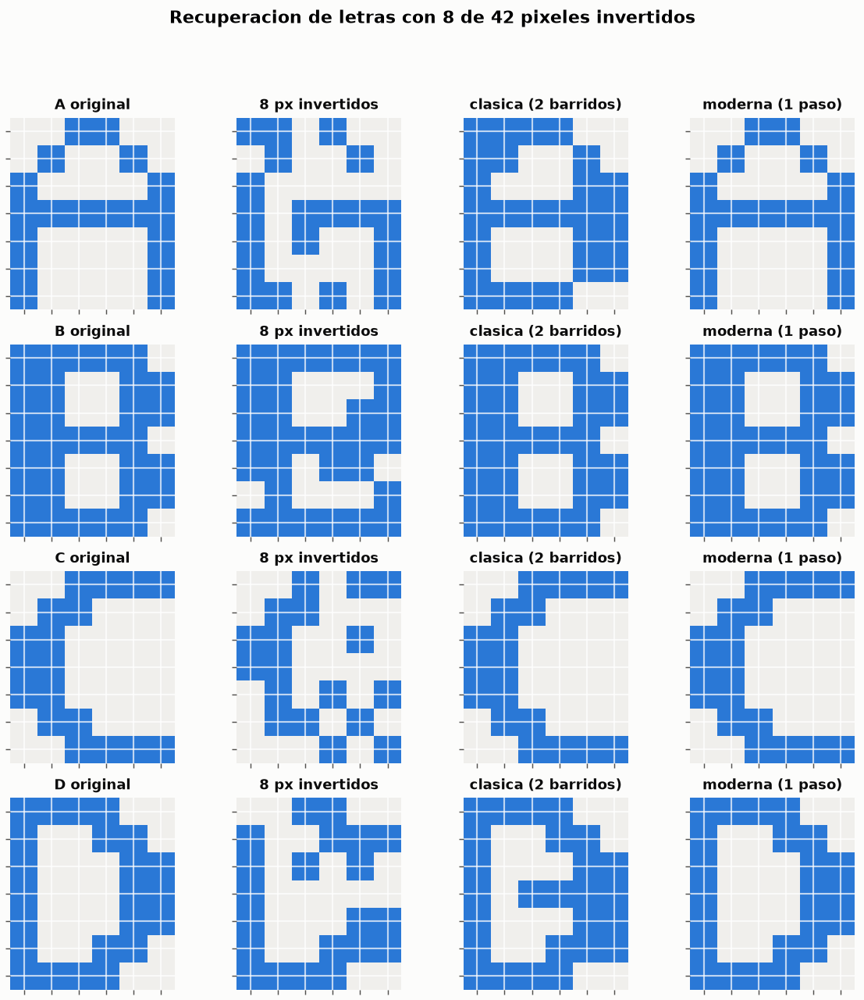
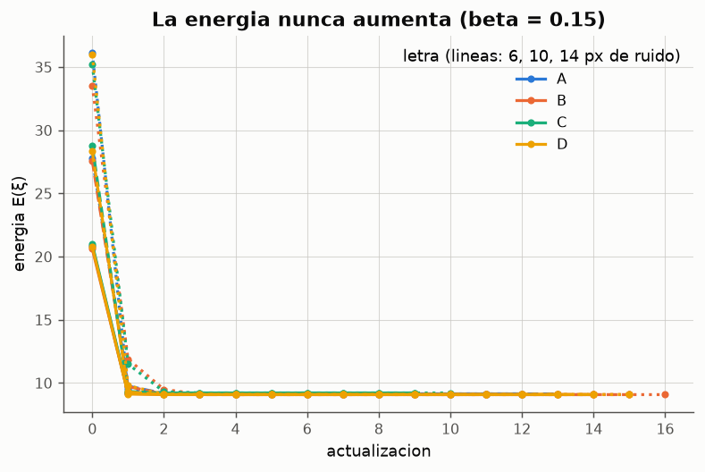
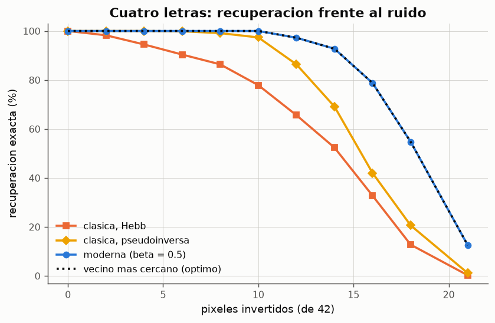
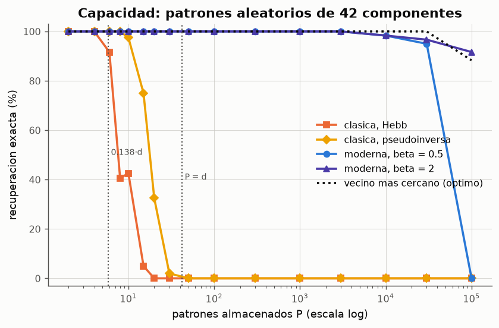
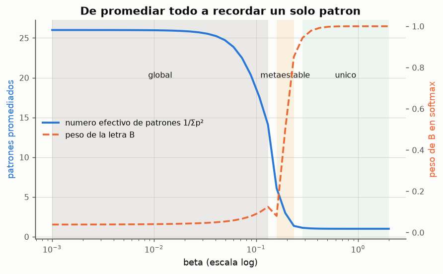
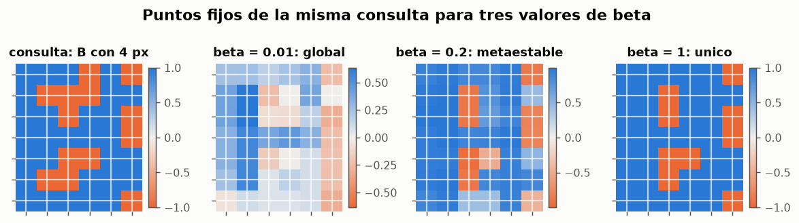
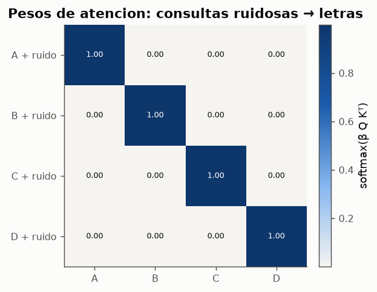

# Experimento 13 --- Red de Hopfield moderna: "Hopfield Networks is All You Need"

> Informe generado automaticamente por los scripts de `experimentos/` el 2026-10-19 08:33.
> No editar a mano: se regenera con `python experimentos/ejecutar_todo.py`.

Implementacion del modelo central de Ramsauer et al. (2021), *Hopfield Networks is All You Need* (ICLR 2021), articulo elegido para el seminario de la Actividad 6. La red de Hopfield moderna sustituye la energia cuadratica de 1982 por un *log-sum-exp* y su regla de actualizacion resulta ser la atencion de los Transformers. Se pone a prueba con las mismas letras de 7x6 pixeles de la Actividad 5 para comparar directamente con la red clasica: recuperacion en un paso, tolerancia al ruido, capacidad, papel de la temperatura inversa beta y equivalencia con la atencion. Todo esta escrito con numpy, sin librerias de aprendizaje automatico.

## 1. Del modelo clasico al moderno

La energia de la red clasica con la regla de Hebb se puede escribir en funcion de los solapamientos del estado con cada patron:

$$
E_{\text{clasica}}(\mathbf{s}) = -\tfrac{1}{2}\,\mathbf{s}^{\top}W\mathbf{s} = -\frac{1}{2N}\sum_{\mu=1}^{P} \bigl(\mathbf{x}_{\mu}^{\top}\mathbf{s}\bigr)^{2}
$$

Cada patron atrae al estado con el **cuadrado** de su solapamiento. Krotov y Hopfield (2016) usaron potencias mayores F(z) = zⁿ y Demircigil et al. (2017) la exponencial: cuanto mas empinada es F, mas domina el patron mas parecido sobre la diafonia de los demas, y la capacidad pasa de crecer linealmente a crecer exponencialmente con la dimension. Ramsauer et al. (2021) generalizan a estados **continuos** con la energia

$$
E(\boldsymbol{\xi}) = -\operatorname{lse}\bigl(\beta, X^{\top}\boldsymbol{\xi}\bigr) + \tfrac{1}{2}\boldsymbol{\xi}^{\top}\boldsymbol{\xi} + \beta^{-1}\log P + \tfrac{1}{2}M^{2}, \qquad \operatorname{lse}(\beta,\mathbf{z}) = \beta^{-1}\log\sum_{\mu} e^{\beta z_{\mu}}
$$

con X = (x₁, …, x_P) los patrones en columnas y M la mayor norma de un patron. El *log-sum-exp* es un maximo suave de los solapamientos y el termino ½‖ξ‖² impide que el estado crezca sin limite. Minimizando E con el procedimiento concavo-convexo se obtiene la regla de actualizacion:

$$
\boldsymbol{\xi}^{\text{nuevo}} = X\,\operatorname{softmax}\bigl(\beta X^{\top}\boldsymbol{\xi}\bigr)
$$

- **No hay pesos que entrenar**: la memoria es la propia matriz de patrones X (d x P). Anadir un patron no modifica a los demas.
- **Estados continuos**: el estado es un vector real, no un vector de ±1.
- **Actualizacion sincrona** de todas las componentes a la vez; la energia baja igualmente (no hace falta la dinamica asincrona de la red clasica).
- **beta** es una temperatura inversa: controla cuanto se concentra softmax en el patron mas parecido.

## 2. Las mismas cuatro letras: recuperacion en una actualizacion

Se almacenan las letras A, B, C y D (trazo grueso, bipolares, d = 42) con beta = 0.5. Con patrones bipolares el producto escalar es x·ξ = d − 2·(distancia de Hamming), asi que beta = 0.5 multiplica por e² ≈ 7.4 el peso relativo de un patron por cada pixel de diferencia. La separacion de cada patron, Δ_μ = x_μ·x_μ − max_{ν≠μ} x_μ·x_ν, es la magnitud que controla el teorema de recuperacion del articulo:

**Separacion de los patrones almacenados**

| letra | separacion_Delta | beta*Delta |
|---|---|---|
| A | 34 | 17 |
| B | 28 | 14 |
| C | 40 | 20 |
| D | 28 | 14 |

*Datos completos: [`13_separacion_abcd.csv`](../tablas/13_separacion_abcd.csv)*

*Figura: Por filas: original, consulta ruidosa, red clasica (Hebb, dinamica asincrona) y red moderna tras una sola actualizacion.*

**Una actualizacion basta**

| letra | clasica_correcta | clasica_barridos | moderna_1_paso_correcta | error_tras_1_paso | iteraciones_hasta_converger | error_final | peso_del_patron_correcto |
|---|---|---|---|---|---|---|---|
| A | False | 2 | True | 0.00815167 | 4 | 6.15971e-07 | 1 |
| B | True | 2 | True | 0.00121589 | 4 | 6.38665e-06 | 0.999999 |
| C | True | 2 | True | 9.4016e-06 | 3 | 2.32134e-08 | 1 |
| D | False | 2 | True | 0.00257511 | 4 | 6.3849e-06 | 0.999999 |

*Datos completos: [`13_un_paso.csv`](../tablas/13_un_paso.csv)*

La red moderna devuelve el patron correcto tras **una sola actualizacion**, con un error de milesimas sobre una norma de √42 ≈ 6.5: es la recuperacion en un paso que predice el articulo para patrones bien separados, con un error que decrece exponencialmente con beta·Δ. Las iteraciones siguientes solo corrigen decimales, y el punto fijo final no es exactamente x_μ sino un punto muy cercano: los demas patrones conservan un peso de softmax minusculo pero no nulo. Por eso se cuenta como acierto que sgn(ξ) coincida con la letra.

*Figura: Energia a lo largo de la recuperacion. Se usa beta = 0.15 para que la convergencia dure varios pasos y se vea la curva; con beta = 0.5 cae en un paso.*

## 3. Tolerancia al ruido: clasica frente a moderna

Mismo protocolo que el experimento 11: para cada letra y cada nivel de ruido se invierten k pixeles al azar (200 consultas por letra y nivel, las mismas para todos los modelos) y se cuenta como acierto solo la recuperacion **exacta** de la letra. Como referencia se incluye el **vecino mas cercano** (la letra a menor distancia de Hamming), que es el mejor resultado posible para una memoria que solo ve la consulta.

**Recuperacion exacta (%) frente al ruido**

| pixeles_invertidos | ruido_% | clasica Hebb_% | clasica pseudoinversa_% | moderna 1 paso_% | moderna_% | vecino mas cercano_% |
|---|---|---|---|---|---|---|
| 0 | 0 | 100 | 100 | 100 | 100 | 100 |
| 2 | 4.7619 | 98.25 | 100 | 100 | 100 | 100 |
| 4 | 9.52381 | 94.5 | 100 | 100 | 100 | 100 |
| 6 | 14.2857 | 90.375 | 99.875 | 100 | 100 | 100 |
| 8 | 19.0476 | 86.375 | 99.125 | 100 | 100 | 100 |
| 10 | 23.8095 | 77.875 | 97.375 | 99.875 | 100 | 100 |
| 12 | 28.5714 | 65.625 | 86.375 | 96.375 | 97.25 | 97.25 |
| 14 | 33.3333 | 52.375 | 69.125 | 90.375 | 92.75 | 92.75 |
| 16 | 38.0952 | 32.75 | 42 | 74 | 78.75 | 78.75 |
| 18 | 42.8571 | 12.75 | 20.625 | 47.75 | 54.75 | 54.75 |
| 21 | 50 | 0.25 | 1.125 | 10 | 12.5 | 12.5 |

*Datos completos: [`13_ruido_abcd.csv`](../tablas/13_ruido_abcd.csv)*

*Figura: La red moderna coincide con el vecino mas cercano: falla solo cuando el ruido acerca la consulta a otra letra.*

Con 16 pixeles invertidos (38 %) la red clasica de Hebb recupera el 33 % de las letras y la moderna el 79 %, igual que el vecino mas cercano (79 %). La red moderna no tiene estados espurios ni inversos con estos patrones: con beta grande softmax elige practicamente el patron de mayor solapamiento, de modo que solo se equivoca cuando la propia consulta ya se parece mas a otra letra. Sus errores son los inevitables.

## 4. Capacidad: el alfabeto completo y patrones aleatorios

*Figura: Mayusculas de DejaVu Sans Bold reducidas a 7x6 con `ce_rna.imagenes.preprocesar`, conservando la proporcion de cada letra.*

Las 26 letras son distintas, pero algunas estan muy cerca: la pareja mas parecida es H-N, a solo 4 pixeles de distancia. La red clasica con Hebb admite unos 0.138·42 ≈ 5.8 patrones aleatorios; 26 letras correlacionadas son casi cinco veces esa capacidad.

**Alfabeto completo (26 patrones, d = 42): recuperacion exacta (%)**

| pixeles_invertidos | ruido_% | clasica Hebb_% | clasica pseudoinversa_% | moderna_% | vecino mas cercano_% |
|---|---|---|---|---|---|
| 0 | 0 | 0 | 100 | 100 | 100 |
| 1 | 2.38095 | 0 | 70 | 100 | 100 |
| 2 | 4.7619 | 0 | 43.1731 | 100 | 100 |
| 3 | 7.14286 | 0 | 20.9615 | 99.9038 | 99.9038 |
| 4 | 9.52381 | 0 | 11.8269 | 99.4231 | 99.4231 |
| 6 | 14.2857 | 0 | 2.98077 | 98.9423 | 98.9423 |

*Datos completos: [`13_ruido_alfabeto.csv`](../tablas/13_ruido_alfabeto.csv)*

Con Hebb **ni siquiera las letras sin ruido son puntos fijos**: la diafonia de 25 memorias borra cualquier patron. La pseudoinversa las convierte en puntos fijos, pero su cuenca de atraccion es minima. La red moderna recupera practicamente todo mientras el ruido no supere la mitad de la distancia entre las letras mas parecidas.

Para ver la capacidad sin depender de la forma de las letras se almacenan P patrones bipolares **aleatorios** de d = 42 componentes, desde 2 hasta 100 000, y se consulta con 6 pixeles invertidos (≈ 14 %). Hasta P = 1000 se promedian 4 repeticiones de 25 consultas; por encima, una repeticion de 60. Para P > 60 la red clasica ya no recupera ningun patron y no se simula (aparece con 0 %).

**Capacidad con patrones aleatorios (d = 42)**

| patrones_P | P/d | clasica Hebb_% | clasica pseudoinversa_% | moderna beta=0.5_% | moderna beta=2_% | vecino mas cercano_% |
|---|---|---|---|---|---|---|
| 2 | 0.047619 | 100 | 100 | 100 | 100 | 100 |
| 4 | 0.0952381 | 100 | 100 | 100 | 100 | 100 |
| 6 | 0.142857 | 91.6667 | 100 | 100 | 100 | 100 |
| 8 | 0.190476 | 40.625 | 100 | 100 | 100 | 100 |
| 10 | 0.238095 | 42.5 | 97.5 | 100 | 100 | 100 |
| 15 | 0.357143 | 5 | 75 | 100 | 100 | 100 |
| 20 | 0.47619 | 0 | 32.5 | 100 | 100 | 100 |
| 30 | 0.714286 | 0 | 2 | 100 | 100 | 100 |
| 50 | 1.19048 | 0 | 0 | 100 | 100 | 100 |
| 100 | 2.38095 | 0 | 0 | 100 | 100 | 100 |
| 300 | 7.14286 | 0 | 0 | 100 | 100 | 100 |
| 1000 | 23.8095 | 0 | 0 | 100 | 100 | 100 |
| 3000 | 71.4286 | 0 | 0 | 100 | 100 | 100 |
| 10000 | 238.095 | 0 | 0 | 98.3333 | 98.3333 | 100 |
| 30000 | 714.286 | 0 | 0 | 95 | 96.6667 | 100 |
| 100000 | 2380.95 | 0 | 0 | 0 | 91.6667 | 88.3333 |

*Datos completos: [`13_capacidad.csv`](../tablas/13_capacidad.csv)*

*Figura: La red clasica se hunde cerca de 0.138·d; la moderna guarda miles de patrones en las mismas 42 dimensiones mientras beta sea suficientemente grande.*

La red clasica con Hebb deja de recuperar todos los patrones a partir de P = 6  cerca de 0.138·d ≈ 5.8. La red moderna con beta = 0.5 recupera al menos el 99 % hasta P = 3 000 y con beta = 2 hasta P = 3 000: miles de veces mas patrones que la clasica con las mismas 42 neuronas.

- **Con beta suficiente, el limite es la geometria**: la curva de beta = 2 se pega al vecino mas cercano. Cuando hay tantos patrones que otro queda a menos distancia de la consulta que el correcto, ningun metodo puede acertar.
- **Con beta pequeno el limite llega antes**: con beta = 0.5 y muchos patrones, la suma de los pesos de miles de patrones "bastante parecidos" supera a la del correcto y la red cae en un estado metaestable (seccion 5). El teorema del articulo lo expresa asi: para recuperar con un paso, beta·Δ debe crecer como el logaritmo del numero de patrones.
- El articulo demuestra que, para patrones aleatorios sobre una esfera, el numero de patrones que se pueden almacenar y recuperar crece **exponencialmente** con la dimension d, frente al crecimiento lineal (0.138·d) de la red clasica.

## 5. El papel de beta: tres tipos de punto fijo

Se almacenan las 26 letras y se consulta con una B con 4 pixeles invertidos, variando beta entre 0.001 y 2. Para cada beta se itera hasta converger y se mira como reparte softmax el peso en el punto fijo. El **numero efectivo de patrones** 1/Σp²_μ vale 1 si todo el peso esta en un patron y 26 si se reparte por igual.

*Figura: Bandas: punto fijo global (gris), estado metaestable (ambar) y patron unico (verde).*

*Figura: Estados continuos: azul = +1 (trazo), naranja = −1 (fondo), blanco = 0 (indeciso).*

**Los tres tipos de punto fijo**

| beta | tipo | patrones_efectivos | cuatro_mayores_pesos |
|---|---|---|---|
| 0.01 | global | 25.9695 | B 0.04, R 0.04, P 0.04, F 0.04 |
| 0.2 | metaestable | 2.26932 | B 0.63, R 0.22, H 0.03, S 0.02 |
| 1 | unico | 1.00001 | B 1.00, R 0.00, S 0.00, H 0.00 |

*Datos completos: [`13_puntos_fijos_beta.csv`](../tablas/13_puntos_fijos_beta.csv)*

**Barrido completo de beta**

| beta | tipo | patrones_efectivos | peso_de_B | mayor_peso | segundo | iteraciones | energia_no_aumenta |
|---|---|---|---|---|---|---|---|
| 0.001 | global | 25.9997 | 0.0386605 | B (0.04) | R (0.04) | 6 | True |
| 0.00121518 | global | 25.9996 | 0.0387037 | B (0.04) | R (0.04) | 6 | True |
| 0.00147667 | global | 25.9994 | 0.0387563 | B (0.04) | R (0.04) | 7 | True |
| 0.00179443 | global | 25.9991 | 0.0388206 | B (0.04) | R (0.04) | 7 | True |
| 0.00218056 | global | 25.9987 | 0.038899 | B (0.04) | R (0.04) | 7 | True |
| 0.00264977 | global | 25.9981 | 0.038995 | B (0.04) | R (0.04) | 7 | True |
| 0.00321996 | global | 25.9971 | 0.0391124 | B (0.04) | R (0.04) | 8 | True |
| 0.00391284 | global | 25.9957 | 0.0392565 | B (0.04) | R (0.04) | 8 | True |
| 0.00475482 | global | 25.9936 | 0.0394335 | B (0.04) | R (0.04) | 8 | True |
| 0.00577798 | global | 25.9904 | 0.0396516 | B (0.04) | R (0.04) | 9 | True |
| 0.00702131 | global | 25.9855 | 0.0399211 | B (0.04) | R (0.04) | 9 | True |
| 0.00853217 | global | 25.9782 | 0.0402554 | B (0.04) | R (0.04) | 10 | True |
| 0.0103682 | global | 25.967 | 0.0406722 | B (0.04) | R (0.04) | 11 | True |
| 0.0125992 | global | 25.9498 | 0.0411948 | B (0.04) | R (0.04) | 11 | True |
| 0.0153104 | global | 25.9231 | 0.0418551 | B (0.04) | R (0.04) | 12 | True |
| 0.0186049 | global | 25.8812 | 0.0426973 | B (0.04) | R (0.04) | 13 | True |
| 0.0226083 | global | 25.8147 | 0.0437843 | B (0.04) | R (0.04) | 15 | True |
| 0.0274733 | global | 25.7072 | 0.0452087 | B (0.05) | R (0.04) | 16 | True |
| 0.0333851 | global | 25.5306 | 0.0471115 | B (0.05) | R (0.05) | 18 | True |
| 0.040569 | global | 25.2348 | 0.0497146 | B (0.05) | R (0.05) | 20 | True |
| 0.0492987 | global | 24.7324 | 0.0533793 | B (0.05) | R (0.05) | 23 | True |
| 0.059907 | global | 23.8792 | 0.0587024 | B (0.06) | R (0.06) | 26 | True |
| 0.072798 | global | 22.4796 | 0.0666483 | B (0.07) | R (0.06) | 29 | True |
| 0.0884629 | global | 20.3793 | 0.0786857 | B (0.08) | R (0.07) | 33 | True |
| 0.107499 | global | 17.5864 | 0.0970141 | B (0.10) | R (0.09) | 40 | True |
| 0.130631 | global | 14.0978 | 0.124756 | B (0.12) | R (0.11) | 51 | True |
| 0.15874 | metaestable | 6.11376 | 0.0803742 | H (0.29) | N (0.23) | 447 | True |
| 0.192898 | metaestable | 2.98997 | 0.498882 | B (0.50) | R (0.28) | 296 | True |
| 0.234407 | metaestable | 1.35957 | 0.851988 | B (0.85) | R (0.10) | 30 | True |
| 0.284847 | unico | 1.12051 | 0.943727 | B (0.94) | R (0.04) | 16 | True |
| 0.346142 | unico | 1.04352 | 0.978761 | B (0.98) | R (0.02) | 11 | True |
| 0.420626 | unico | 1.01504 | 0.992541 | B (0.99) | R (0.01) | 9 | True |
| 0.511137 | unico | 1.00463 | 0.99769 | B (1.00) | R (0.00) | 7 | True |
| 0.621125 | unico | 1.00119 | 0.999408 | B (1.00) | R (0.00) | 5 | True |
| 0.754781 | unico | 1.00023 | 0.999883 | B (1.00) | R (0.00) | 4 | True |
| 0.917197 | unico | 1.00003 | 0.999983 | B (1.00) | R (0.00) | 4 | True |
| 1.11456 | unico | 1 | 0.999998 | B (1.00) | R (0.00) | 3 | True |
| 1.3544 | unico | 1 | 1 | B (1.00) | R (0.00) | 3 | True |
| 1.64584 | unico | 1 | 1 | B (1.00) | R (0.00) | 3 | True |
| 2 | unico | 1 | 1 | B (1.00) | R (0.00) | 2 | True |

*Datos completos: [`13_barrido_beta.csv`](../tablas/13_barrido_beta.csv)*

- **Punto fijo global** (beta pequeno): softmax reparte el peso casi por igual y el estado converge a la media de las 26 letras, la misma para cualquier consulta. La red no recuerda nada concreto.
- **Estado metaestable** (beta intermedio): el peso se reparte entre un grupo de letras parecidas y el estado es su promedio. El articulo interpreta estos estados como una memoria de *grupos*: recuperan lo que tienen en comun varios patrones.
- **Punto fijo de un patron** (beta grande): todo el peso va a la letra mas parecida y se recupera la B. Es el comportamiento de memoria asociativa de la Actividad 5.
- En los 40 valores de beta la energia **nunca aumenta**: se cumple en todos.

En los Transformers beta = 1/√d_k es fijo, pero las proyecciones aprendidas escalan los productos escalares, de modo que cada cabeza de atencion opera en uno de estos tres regimenes. El articulo analiza asi las cabezas de BERT: las de las primeras capas tienden a promediar globalmente y las de capas superiores promedian parcialmente, en estados metaestables.

## 6. Equivalencia con la atencion de los Transformers

Si los estados (consultas) R y los patrones almacenados Y pasan por proyecciones lineales aprendidas, Q = R·W_Q, K = Y·W_K, V = K·W_V, y se toma beta = 1/√d_k, aplicar la regla de actualizacion a todas las consultas a la vez da

$$
Z = \operatorname{softmax}\!\Bigl(\tfrac{1}{\sqrt{d_k}}\,Q K^{\top}\Bigr) V
$$

que es exactamente la atencion de producto escalar de Vaswani et al. (2017). Se comprueba numericamente:

**Atencion frente a actualizacion de Hopfield**

| caso | consultas | patrones | d_k | d_v | max_diferencia_absoluta |
|---|---|---|---|---|---|
| proyecciones aleatorias | 4 | 4 | 42 | 42 | 1.77636e-15 |
| proyecciones aleatorias | 5 | 26 | 16 | 8 | 0 |
| proyecciones aleatorias | 10 | 100 | 64 | 64 | 4.10338e-13 |
| letras ruidosas, K = V = letras | 4 | 4 | 42 | 42 | 1.11022e-16 |

*Datos completos: [`13_atencion.csv`](../tablas/13_atencion.csv)*

Las diferencias no pasan de 10⁻¹², el redondeo de punto flotante: son la **misma operacion**. La ultima fila lo hace sin proyecciones: una capa de atencion cuyas claves y valores son las cuatro letras recupera las letras limpias a partir de consultas con 8 pixeles invertidos, en una sola pasada.

*Figura: Cada consulta pone casi todo su peso en su propia letra: la matriz de atencion es la diagonal.*

## 7. Conclusiones

- La red de Hopfield moderna cabe en tres lineas de numpy: similitudes, softmax y promedio ponderado. No tiene pesos que entrenar: la memoria son los propios patrones.
- Con las letras de la Actividad 5 recupera en **una sola actualizacion**, tolera tanto ruido como el vecino mas cercano (el optimo) y no produce estados espurios ni inversos.
- Su capacidad no esta limitada por la diafonia: guarda las 26 letras (Hebb no guarda ni una) y miles de patrones aleatorios en 42 dimensiones, siempre que beta crezca con el numero de patrones.
- beta decide si la red promedia todo, recuerda grupos (estados metaestables) o recuerda un patron; la energia baja en todos los casos.
- Su regla de actualizacion **es** la atencion de los Transformers, comprobado hasta el redondeo: el puente entre la memoria asociativa de 1982 y el aprendizaje profundo actual.
- Limitacion: guarda los patrones explicitamente, de modo que memoria y coste crecen con P (la red clasica comprime todo en una matriz d x d). Y en datos reales hay que aprender las proyecciones W_Q, W_K, W_V con retropropagacion, como hace el articulo.
